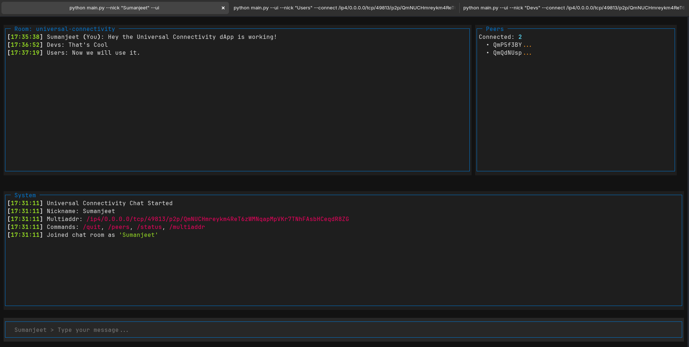

# py-peer 🌐

A Python implementation of the Universal Connectivity peer-to-peer chat application using libp2p networking with multiple UI options, a Tornado API layer, and a React web frontend.

This is the Python implementation of the [Universal Connectivity][UNIV_CONN] app showcasing the [Gossipsub][GOSSIPSUB] features of the core libp2p protocol as found in the [py-libp2p][PYLIBP2P] Python libp2p implementation. The implementation supports simultaneous multi-transport (TCP, WebSocket, QUIC-v1, WebTransport, and WebRTC-Direct).

## 📋 Table of Contents

- [Overview](#overview)
- [Features](#features)
- [Screenshots](#screenshots)
- [Architecture](#architecture)
- [Prerequisites](#prerequisites)
- [Installation](#installation)
- [Docker Deployment](#docker-deployment)
- [Usage](#usage)
- [User Interfaces](#user-interfaces)
- [Configuration](#configuration)
- [Development](#development)
- [Troubleshooting](#troubleshooting)
- [Contributing](#contributing)

## 🚀 Overview

py-peer is a decentralized chat application that enables peer-to-peer communication without requiring central servers. Built on libp2p, it provides secure, direct communication between participants using modern networking protocols. It offers multiple interaction modes: a terminal-based Textual TUI, a simple CLI, and a React frontend powered by a Tornado REST + WebSocket API.

Textual and CLI modes run with direct in-process access to the HeadlessService. The React frontend is decoupled and communicates with HeadlessService through Tornado REST and WebSocket endpoints. No graphical toolkit is required: the runtime, TUI, CLI, and API are pure Python.

## 📸 Screenshots

### Textual TUI Interface


*The Textual Terminal User Interface showing a live chat session with multiple connected peers. The interface features a main chat area, connected peers panel, system messages, and input field.*

## 🎯 Key Technologies

- **[libp2p](https://libp2p.io/)** - Modular peer-to-peer networking stack
- **[Trio](https://trio.readthedocs.io/)** - Async/await framework for Python
- **[Textual](https://textual.textualize.io/)** - Modern Terminal User Interface framework
- **[Tornado](https://www.tornadoweb.org/)** - REST and WebSocket API server
- **[React + Vite](https://vitejs.dev/)** - Modern web frontend for py-peer
- **[GossipSub](https://docs.libp2p.io/concepts/pubsub/overview/)** - Pub/sub messaging protocol

## ✨ Features

### Core Features
- **Peer-to-Peer Chat** - Direct communication without central servers
- **Multiple UI Modes** - Textual TUI, simple CLI, or the REST/WebSocket API with a React frontend
- **Real-time Messaging** - Instant message delivery through GossipSub
- **Peer Discovery** - Automatic discovery of other peers in the network
- **Cross-Platform** - Works on Linux, macOS, and Windows
- **Secure Communication** - Built-in encryption and peer authentication
- **REST + WebSocket API** - Full Tornado API for programmatic control and real-time streams
- **Web Frontend** - React dashboard for chat, topic management, and peer operations

### Advanced Features (NEW!)
- **Topic-Based Conversations** - Subscribe to and chat in multiple topics simultaneously
- **Dynamic Topic Management** - Add new topics on the fly without restarting
- **Per-Topic Message Storage** - Messages organized by topic with read/unread tracking, stored in a local SQLite database under the data directory
- **Dynamic Peer Connection** - Connect to peers using their multiaddress through the API or CLI
- **Message Filtering** - View messages only for the selected topic
- **Custom Topics** - Use custom topic names via command line or UI
- **Persistent Connections** - Automatic peer connection maintenance
- **File Sharing API** - Share/download files via Bitswap/MerkleDag API endpoints

### UI-Specific Features

#### Textual TUI Features
- Live peer count display
- System message logging
- Interactive command support
- Real-time chat updates

#### CLI Features
- Simple text-based interface
- Command history
- Minimal resource usage

#### React Frontend Features
- Browser-based chat UI with live updates
- Connection panel for peer connect + topic subscribe
- Topic sidebar with unread counts
- WebSocket-backed real-time messages and peer updates

## 🏗️ Architecture

**Access model:**
- One `ApplicationRuntime` (`app/`) owns the single libp2p host and service instances per process
- Textual TUI and CLI call runtime services in-process; incoming messages and
  peer changes arrive on the shared bounded `EventBus` (no HTTP hop)
- React frontend reaches the same services through Tornado REST (`/api/v1/*`) and WebSockets (`/ws/*`); it retries automatically when the backend restarts
- A future MCP adapter can expose the same services without duplicating networking code

```
┌────────────────────────────────────┐      ┌──────────────────────────────┐
│ Local UI Path (Choose One)         │      │ Web Client Path              │
├────────────────────────────────────┤      ├──────────────────────────────┤
│ Textual TUI / CLI                  │      │ React Frontend (Vite + TS)   │
│                                    │      │ • /api/v1 calls              │
│ • In-process access                │      │ • /ws streams                │
│ • No HTTP hop required             │      │                              │
└───────────────────┬────────────────┘      └──────────────┬───────────────┘
                    │                                       │
                    │ direct in-process                     │ HTTP + WS
                    │                                       │
                    │                              ┌────────▼────────┐
                    │                              │   Tornado API    │
                    │                              │ • REST endpoints │
                    │                              │ • WebSockets     │
                    │                              │ • CORS + JSON    │
                    │                              └────────┬─────────┘
                    │                                       │
                    └───────────────────────┬───────────────┘
                                            │
                                  ┌─────────▼─────────┐
                                  │  Headless Service  │
                                  │ • Message Queue    │
                                  │ • Topic Storage    │
                                  │ • Event Loop       │
                                  │ • State Mgmt       │
                                  └─────────┬─────────┘
                                            │
                                  ┌─────────▼─────────┐
                                  │     Chat Room     │
                                  │ • libp2p Host     │
                                  │ • PubSub/GossipSub│
                                  │ • DHT             │
                                  │ • Topic Handlers  │
                                  └─────────┬─────────┘
                                            │
                                  ┌─────────▼─────────┐
                                  │    P2P Network    │
                                  │ • Peer Discovery  │
                                  │ • Message Relay   │
                                  │ • Topic Routing   │
                                  └───────────────────┘
```

### Components

- **main.py** - Application entry point and argument parsing
- **core/** - Transport engine and shared transport definitions
  - **headless.py** - Background engine managing libp2p operations (the runtime's transport layer)
  - **constants.py** - Transport limits, bootstrap peers, and defaults
  - **healthcheck.py** - Container readiness probe
- **app/** - Framework-independent runtime, chat domain, and services (peer, connection, messaging, discovery, identity, files, storage)
  - **chatroom.py** - Chat room logic, topic management, message handling, and peer nicknames
- **api/** - Versioned API handlers (node, peers, topics, messages, files, dht, pubsub, identity, service, websocket)
  - **server.py** - Tornado REST + WebSocket server bootstrap and route wiring
- **ui/** - Textual terminal interface
  - **textual.py** - Textual TUI implementation
- **React web frontend** - separate `py-peer-frontend` project (sibling checkout) consuming the API

### Message Flow

```
User Input → UI Thread → Queue → Async Thread (Trio)
                                      ↓
                              HeadlessService
                                      ↓
                                  ChatRoom
                                      ↓
                              GossipSub/PubSub
                                      ↓
                                  P2P Network
                                      ↓
                              Other Peers
```

## 📋 Prerequisites

- **Python 3.12+**
- **uv** (recommended) or pip package manager
- Network connectivity for peer-to-peer communication
- For React frontend: **Node.js 18+** and npm

### Supported platforms

Do not assume universal support just because the wheel is pure Python: libp2p
and `fastecdsa` ship native or platform-specific dependencies.

| Target | Status | Notes |
|---|---|---|
| macOS 14+ (arm64) | **Tested** | Real host lifecycle, wheel install, Docker Desktop host |
| Linux arm64 (Debian bookworm, Python 3.12, container) | **Tested** | Headless runtime, health check, two-container connectivity, persistence |
| Linux x86_64 | Expected, not tested in this repository | Same Python 3.12 requirements; verify native wheels before release |
| Windows 11 | Expected, not tested in this repository | TCP only; no native test, no service installer |
| Android/iOS | Not supported | The former Kivy mobile path was removed |

Simultaneous multi-transport is enabled by default. `py-peer` listens across all 5 transports:
- **TCP** (`/ip4/0.0.0.0/tcp/<port>`)
- **WebSocket** (`/ip4/0.0.0.0/tcp/<port>/ws`, demultiplexed over the same TCP port)
- **QUIC-v1** (`/ip4/0.0.0.0/udp/<port>/quic-v1`)
- **WebTransport** (`/ip4/0.0.0.0/udp/<port+1>/quic-v1/webtransport`)
- **WebRTC-Direct** (`/ip4/0.0.0.0/udp/<port+2>/webrtc-direct`)

Both IPv4 and IPv6 loopback are supported; LAN use requires `--announce-host` and opening the corresponding TCP/UDP firewall ports.

## 🛠️ Installation

### Option 1: Using uv (Recommended)

```bash
# Clone the repository
git clone https://github.com/libp2p/universal-connectivity.git
cd universal-connectivity/py-peer

# Create virtual environment
uv venv

# Activate virtual environment
source .venv/bin/activate  # Linux/macOS
# or
.venv\Scripts\activate     # Windows

# Install the package
uv pip install -e .
```

### Option 2: Using pip

```bash
# Clone the repository
git clone https://github.com/libp2p/universal-connectivity.git
cd universal-connectivity/py-peer

# Create virtual environment
python -m venv .venv

# Activate virtual environment
source .venv/bin/activate  # Linux/macOS
# or
.venv\Scripts\activate     # Windows

# Install the package
pip install -e .
```

### Option 3: Build and install a wheel

`uv build` produces a small runtime wheel and a source distribution. The wheel
contains the root runner modules plus `api/` and `app/`; it excludes
the React workspace, `node_modules`, Docker assets, local databases, and
caches. The sdist additionally contains the Docker files and `uv.lock`.

```bash
cd py-peer
uv build                     # dist/py_peer-0.1.0-py3-none-any.whl + .tar.gz

python -m venv /tmp/py-peer-venv
/tmp/py-peer-venv/bin/pip install dist/py_peer-0.1.0-py3-none-any.whl

# Run the installed console script from outside the repository
cd /tmp
/tmp/py-peer-venv/bin/py-peer --help
/tmp/py-peer-venv/bin/py-peer --api-routes
```

The wheel pins the tested libp2p fork to one git commit
(`fbf4ff94d7201edfa90992574c4879738f2dab96`), so a clean install needs network
access and `git` to build that dependency. It does **not** install Kivy or any
UI framework beyond Textual, and it never writes into the installation
directory: identity, history, and logs go to the data directory described
below. Upgrading the package leaves that directory untouched.

`pipx install` and `uv tool install` work with the same wheel, but they were not
separately exercised in this repository; the clean-venv install above is the
verified path.

### Static type checks

The application code is checked with mypy and Pyrefly, matching py-libp2p's
two-checker setup. libp2p ships type information, so the transport and chat
layers use its interfaces (`IHost`, `ISubscriptionAPI`, `Message`) instead of
untyped stand-ins.

```bash
pip install -e '.[dev]'
# or using uv:
uv pip install -e '.[dev]'
mypy
pyrefly check
pytest
```

`mypy` reads `[tool.mypy]` in `pyproject.toml`, checks `main.py`, `core`, `app`,
`api`, and `ui`, and reports the same errors in CI or locally. The configuration
follows py-libp2p's strict policy: every function is annotated, untyped calls
and bare generics are rejected, and optional/equality checking stays strict.

`pyrefly` reads `[tool.pyrefly]` from the same file and checks the same modules.
Its report is also clean. Packages that do not ship type information in every
install are excluded or treated as `Any`. Tornado's handler override check is
relaxed for `api/` because route arguments are not part of Tornado's base
method signatures; all other Pyrefly checks stay enabled.

The same checks are available through the py-libp2p-style wrappers:

```bash
tox -e type
pre-commit run mypy-local --all-files
pre-commit run pyrefly-local --all-files
```

The GitHub Actions workflow lives at the repository root in
`.github/workflows/py-peer-typecheck.yml`. It runs the identical `mypy` and
`pyrefly` commands with `py-peer` as the working directory whenever `py-peer`
changes.

## 🐳 Docker Deployment

The `Dockerfile` and `docker-compose.yml` run the peer in headless mode with the
Tornado REST/WebSocket API. The React frontend is **not** bundled into the
Python image; deploy it separately and point it at the published API.

### Build and run

```bash
cd py-peer

docker compose build
docker compose up -d
docker compose logs -f
docker compose ps
```

Stop and remove the container while keeping data:

```bash
docker compose down          # keeps the named volume
```

Delete the peer identity, history, and logs as well:

```bash
docker compose down -v       # DESTRUCTIVE: removes the data volume
```

Restart with the same volume:

```bash
docker compose up -d
```

Building directly without Compose works too:

```bash
docker build -t py-peer:local .
docker run -d --name uc-peer --init \
  -e UC_DATA_DIR=/data \
  -v uc-data:/data \
  -p 4001:4001/tcp \
  -p 127.0.0.1:8765:8765 \
  py-peer:local \
  --api --api-host 0.0.0.0 --announce-host 192.168.1.50 --nick alice
```

The image is multi-stage: `uv` installs exactly `uv.lock` into `/app/.venv`
in a builder stage, and only the virtual environment plus application code
reach the final `python:3.12-slim-bookworm` image. Build tools and `git` stay
in the builder.

### Compose settings

Compose reads these variables from the shell or a local `.env` file. The
defaults are safe for same-host testing; set the network-specific values for
real peers.

| Variable | Default | Purpose |
|---|---|---|
| `UC_NICKNAME` | `docker-peer` | Peer nickname |
| `UC_PEER_PORT` | `4001` | libp2p TCP port, inside and published |
| `UC_API_PORT` | `8765` | Tornado API port, inside and published |
| `UC_API_PUBLISH_HOST` | `127.0.0.1` | Host interface for the API mapping |
| `UC_ANNOUNCE_HOST` | `127.0.0.1` | Host advertised to other peers |
| `UC_DATA_DIR` | `/data` | Set by Compose; backed by the named volume |

Example `.env` (gitignored):

```dotenv
UC_NICKNAME=alice
UC_PEER_PORT=4001
UC_API_PORT=8765
UC_API_PUBLISH_HOST=127.0.0.1
UC_ANNOUNCE_HOST=192.168.1.50
```

### Data and permissions

The container runs as the unprivileged user `uc` (UID/GID `10001`). Durable
state is stored only on the `/data` volume:

```text
/data/
├── identity/peer.key          # stable peer identity, survives recreation
├── history.db                 # SQLite message history
└── logs/system_messages.txt   # rotating application log
```

A named volume inherits `/data` ownership from the image, so
`docker compose down` followed by `up -d` keeps the same peer ID and message
history. If you use a bind mount instead, chown it first:

```bash
mkdir -p ./peer-data
sudo chown -R 10001:10001 ./peer-data
```

### Ports and advertised addresses

`py-peer` publishes both TCP and UDP ports for simultaneous multi-transport connectivity:

| Port | Protocol | Purpose |
|---|---|---|
| `4001` | TCP | libp2p TCP & WebSocket (demultiplexed) |
| `4001` | UDP | libp2p QUIC-v1 transport |
| `4002` | UDP | libp2p WebTransport |
| `4003` | UDP | libp2p WebRTC-Direct transport |
| `8765` | TCP | REST + WebSocket API |

Inside the container the listener binds `/ip4/0.0.0.0/tcp/4001`, but a
wildcard address is not a dial target. The peer rewrites it using
`--announce-host`, so the advertised multiaddr is:

```text
/ip4/<UC_ANNOUNCE_HOST>/tcp/<UC_PEER_PORT>/p2p/<peer-id>
```

With the default `UC_ANNOUNCE_HOST=127.0.0.1`, the address is only reachable
from the same host. For peers on a LAN, set `UC_ANNOUNCE_HOST` to the Docker
host's LAN IP and make sure the host firewall allows TCP 4001. Container IPs
(for example `172.17.0.x`) must never be advertised outside the Docker
network. Internet reachability also requires a port forward on the router;
automatic NAT traversal/relay is not implemented. On Linux, host networking is
an alternative when you do not want port mapping:

```bash
docker run --network host ... py-peer:local \
  --api --api-host 127.0.0.1 --announce-host 192.168.1.50
```

### API exposure

The API has no authentication and returns wildcard CORS headers. Compose
therefore publishes it on `127.0.0.1` by default even though the container
listener binds `0.0.0.0` (required for Docker's port forwarding). Only set
`UC_API_PUBLISH_HOST=0.0.0.0` behind a firewall and an authenticating reverse
proxy.

### Health, shutdown, and logs

The built-in health check runs `core/healthcheck.py`, which parses
`GET /api/v1/service/status` and requires `ready=true`, `running=true`, and
`failed=false`. A plain HTTP 200 is not enough: the API can answer before the
libp2p host is ready.

Compose runs with `init: true`. `docker stop`/`docker compose stop` sends
SIGTERM, `main.py` requests a graceful shutdown, joins the runtime thread, and
exits 0. Compose rotates Docker logs at 10 MB with three files; the application
also rotates `<data-dir>/logs/system_messages.txt`.

## 🎯 Usage

### Quick Start

```bash
# Textual TUI (Terminal interface)
python main.py --ui --nick Bob

# Simple CLI mode
python main.py --nick Charlie

# Headless mode (no UI)
python main.py --headless --nick Dave

# Tornado API mode (REST + WebSocket)
python main.py --api --nick Eve --api-port 8765

# Print all API routes and exit
python main.py --api-routes
```

### Command Line Options

| Option | Description | Example |
|--------|-------------|---------|
| `--nick NAME` | Set your nickname (required) | `--nick Alice` |
| `--ui` | Use Textual TUI interface | `--ui` |
| `--headless` | Run without UI (logs only) | `--headless` |
| `-c, --connect ADDR` | Connect to specific peer | `-c /ip4/...` |
| `-p, --port PORT` | Set listening port | `-p 8080` |
| `--announce-host HOST` | Host advertised for wildcard listeners (default `127.0.0.1`; ignored when `--announce-addr` is given) | `--announce-host 192.168.1.50` |
| `--listen-addr MULTIADDR` | Multiaddr to listen on (repeatable). Default `/ip4/0.0.0.0/tcp/<port>` | `--listen-addr /ip4/127.0.0.1/tcp/4001` |
| `--announce-addr MULTIADDR` | Multiaddr advertised verbatim (repeatable). Overrides `--announce-host`; wildcard hosts are rejected | `--announce-addr /ip4/192.168.1.50/tcp/4001` |
| `-t, --topic TOPIC` | Set custom default topic | `-t my-topic` |
| `-s, --seed SEED` | Deterministic peer ID for development/testing (not written to disk). Default: a persisted random identity | `-s 12345` |
| `--data-dir PATH` | Directory for identity, history, and logs (default `$UC_DATA_DIR`, else the platform data directory) | `--data-dir ./peer-data` |
| `--storage-path PATH` | Override just the SQLite history file (`:memory:` for an ephemeral database) | `--storage-path ./data/history.db` |
| `-v, --verbose` | Enable debug logging | `-v` |
| `--no-strict-signing` | Allow unsigned messages | `--no-strict-signing` |
| `--api` | Start Tornado REST + WebSocket API server | `--api` |
| `--api-port PORT` | Set Tornado API port | `--api-port 8765` |
| `--api-host HOST` | Interface for the API (default `127.0.0.1`; the API is unauthenticated) | `--api-host 0.0.0.0` |
| `--api-routes` | Print all API routes and exit | `--api-routes` |

### API Trust Boundary

The Tornado API has **no authentication** and answers with
`Access-Control-Allow-Origin: *`. It binds to `127.0.0.1` by default and is
intended for a trusted local client (the React dev server or a local script).
Do not expose it to an untrusted network without a reverse proxy that enforces
authentication and an origin policy. `--api-host 0.0.0.0` exists for containers
and explicitly trusted networks and logs a warning when used.

### Connecting Peers

**Peer 1:**
```bash
python main.py --ui --nick Alice --port 9095
# Copy your advertised multiaddr from the startup log
```

**Peer 2:**
```bash
# Use the multiaddr from Peer 1
python main.py --ui --nick Bob --connect /ip4/192.168.1.100/tcp/9095/p2p/QmXXX...
```

> **Running several peers on one machine:** every peer defaults to port `4001`, and
> libp2p enables `SO_REUSEPORT`, so a second peer *can* bind the same port. Inbound
> connections are then delivered to whichever process the kernel picks, which shows
> up as `handshake failed when upgrading to secure connection`. Give each peer its
> own `--port` (`4001`, `4002`, ...) and dial `127.0.0.1` rather than `0.0.0.0`
> (`0.0.0.0` is a bind address, not a dial target — the peer rewrites it for you).
>
> ```bash
> python main.py --seed 1 --port 4001 --api --api-port 8765
> python main.py --seed 2 --port 4002 --api --api-port 8766
> # then connect to /ip4/127.0.0.1/tcp/4002/p2p/<seed-2-peer-id>
> ```
>
> The default data directory holds **one** peer identity, so two peers that
> share it also share a peer ID and history file. Give each peer its own
> `--data-dir` (or use `--seed`) when running several on one machine.

### Addresses: listen vs advertised

The peer tracks three address concepts separately:

| Concept | What it means | How to set it |
|---|---|---|
| **Listen (bind)** | Interfaces/ports the sockets bind | `--listen-addr` (repeatable); default `/ip4/0.0.0.0/tcp/<port>` |
| **Advertised** | Addresses shared with other peers | Derived from the live listener. Wildcard binds are rewritten to `--announce-host`; `--announce-addr` overrides both |
| **Observed** | Addresses remote peers report via Identify | Recorded by py-libp2p; not user-configurable |

Notes:

- The default `--announce-host` is `127.0.0.1`, so a default peer can only be
  dialled from the same machine. The startup log prints the dialability class and
  warns when the advertised address is loopback.
- On a LAN, pass your machine's address:
  ```bash
  python main.py --nick Alice --port 4001 --announce-host 192.168.1.50
  ```
- For full control (multiple addresses, IPv6, or a host port mapping), pass
  one or more concrete multiaddrs:
  ```bash
  python main.py --nick Alice --listen-addr /ip6/::1/tcp/4001 \
      --announce-addr /ip6/::1/tcp/4001
  ```
- Wildcard hosts (`0.0.0.0`, `::`) are rejected as announce addresses because
  they are not dial targets.
- Listener startup is verified. If a requested address cannot bind, the peer
  fails to start instead of advertising an address nothing is listening on.
- Docker/NAT deployments must announce a host-reachable address; automatic
  public-address discovery is not implemented.

## 🖥️ User Interfaces

Textual and CLI run against the local in-process HeadlessService. React frontend clients connect over HTTP/WebSocket through the Tornado API layer.

**Support policy:** the Textual TUI, simple CLI, headless mode, and Tornado API are the supported interfaces. There is no graphical UI toolkit dependency.

### 1. Textual TUI

**Features:**
- Terminal-based interface
- Live peer count
- System messages panel
- Command support

**Commands:**
- `/quit` - Exit the chat
- `/peers` - Show connected peers
- `/status` - Display connection status
- `/multiaddr` - Show your multiaddress

**Note:** Copy the multiaddr from the system log at
`<data-dir>/logs/system_messages.txt` for sharing.

### 2. Simple CLI Mode

**Features:**
- Minimal interface
- Direct input/output
- Command history
- Low resource usage

**Usage:**
Just type messages and press Enter. Use `/quit` to exit.

### 3. React Web Frontend

The React frontend lives in the separate `py-peer-frontend` project (a sibling
checkout of this repository) and uses the Tornado API.

**Start backend API:**
```bash
python main.py --api --nick Alice --api-port 8765
```

**Start frontend (new terminal):**
```bash
cd ../py-peer-frontend
npm install
npm run dev
```

Open `http://localhost:3000`.

**Production/remote backend:**
- Set `VITE_API_URL` in `py-peer-frontend/.env.local`
- Example: `VITE_API_URL=https://your-backend.example.com`

## ⚙️ Configuration

### Custom Topics

**Via Command Line:**
```bash
python main.py --ui --nick Alice --topic my-custom-topic
```

**At runtime:** subscribe through the API with `POST /api/v1/topics` and
`{"topic": "my-custom-topic"}`.

### Dynamic Peer Connection

1. Get the other peer's multiaddr from the startup log or
   `GET /api/v1/node/multiaddr`.
2. Connect in either of these ways:
   - Start with `--connect <multiaddr>` / `-c <multiaddr>`.
   - API: `POST /api/v1/peers/connect` with `{"multiaddr": "..."}`.

### Message Storage

Messages are stored per-topic with read/unread tracking:
- Unread messages appear in topic list
- Opening a topic marks messages as read
- Every message gets a stable `message_id`; a frame delivered twice is stored
  and shown once
- History is capped at 1000 messages per topic
- History is written to `<data-dir>/history.db` and survives restarts

To use a different database location (or keep history in memory only):

```bash
python main.py --storage-path ./data/history.db
python main.py --storage-path :memory:
```

The database uses a versioned schema in WAL mode. It is a local store only: it
does **not** deliver messages to peers that were offline, and it is not a
network-wide history. Back up with
`sqlite3 <data-dir>/history.db ".backup 'backup.db'"` (or copy the file while
the peer is stopped) and restore by replacing it while stopped.

### Configuration Precedence and Limits

There is no configuration file. Values resolve in this order:

1. **CLI flag** (for example `--data-dir`, `--port`, `--api-host`, `--api-port`)
2. **Environment variable** where one exists:
   - `UC_DATA_DIR` — same as `--data-dir`
   - `UC_HEALTHCHECK_URL` — used only by the container health probe
3. **Built-in default**

The `UC_*` variables in `docker-compose.yml` are **Compose substitutions** used to
build the container command and port mappings; the peer runtime only reads
`UC_DATA_DIR` from the environment (`core/healthcheck.py` reads
`UC_HEALTHCHECK_URL`). Keep
Compose values and any explicit CLI flags consistent, because a CLI flag inside
`command:` wins.

| Setting | Default | Notes |
|---|---|---|
| Peer port | `4001` (`--port 0` binds ephemeral ports) | Compose/Docker pass `4001` explicitly |
| Listen addresses | All 5 transports (TCP, WS, QUIC, WebTransport, WebRTC-Direct) | Default binds all transports on `<port>`, `<port>+1` (WebTransport) and `<port>+2` (WebRTC-direct); custom `--listen-addr` repeatable |
| Advertised host | `127.0.0.1` | Same-machine only; set a dialable address for LAN/Docker |
| API port | `8765` | |
| API host | `127.0.0.1` | Unauthenticated; `0.0.0.0` is explicit opt-in |
| Data directory | platformdirs path | Overridden by `UC_DATA_DIR` or `--data-dir` |
| History retention | 1000 messages/topic | Fixed in this build; hard maximum 100,000 |
| Chat message size | 4096 characters | Enforced by the service for every adapter |
| Inbound gossip frame | 64 KiB | Larger frames are dropped before decoding |
| Topic name | 128 characters | Validated on subscription |
| Upload size | 25 MB per file | HTTP body cap is 25 MB + 1 MB multipart headroom |
| Event queue | 256 events/subscriber | Slow consumers drop the oldest event |
| Legacy UI queues | 64–1024 items | Bounded; non-blocking command queues |

Configuration is validated before the runtime reports ready: invalid ports,
malformed listen addresses, wildcard announce addresses, and
unwritable data directories fail startup with a clear error. If you need a
configuration file or different retention, it is not implemented yet rather
than silently ignored.

### Security and Operational Assumptions

- The API has no authentication or rate limiting. It is a trusted-local
  interface; put an authenticating reverse proxy and firewall in front before
  binding it to a non-loopback interface.
- Identity keys are written with mode `0600`. Seed values, keys, and message
  contents are not logged at normal verbosity.
- Message payloads, pubsub traffic, DHT records, and bootstrap peer responses
  are untrusted input. `--no-strict-signing` weakens pubsub authenticity and is
  for development only.
- History retention bounds disk growth per topic, but there is no global quota
  or automatic retention change. A disk-full write is reported and does not
  stop live delivery.
- Corrupt or newer-schema databases fail startup without overwriting the file;
  back up while stopped (or use `sqlite3 ... ".backup"`) before upgrading.

### Tornado API Configuration

The API runs in headless + server mode and exposes REST + WebSocket endpoints.

```bash
python main.py --api --nick MyNode --api-port 8765
```

- Base URL: `http://localhost:8765/api/v1`
- Route listing: `python main.py --api-routes`

### Data Directory

Identity, message history, and logs live in one directory so they can be
backed up, moved, or deleted together:

```text
<data-dir>/
├── identity/peer.key          # private peer identity (mode 0600)
├── history.db                 # SQLite message history
└── logs/system_messages.txt   # rotating system log
```

The location is chosen at startup, first match wins:

1. `--data-dir PATH`
2. `UC_DATA_DIR` environment variable
3. the platform data directory: `~/Library/Application Support/py-peer` on
   macOS, `$XDG_DATA_HOME/py-peer` on Linux, `%LOCALAPPDATA%\py-peer` on
   Windows

```bash
export UC_DATA_DIR=/var/lib/py-peer
python main.py --api --nick Alice

# or per run
python main.py --api --nick Alice --data-dir ./peer-data
```

**Identity:** the first run creates a random Ed25519 key and reuses it on every
later run, so the peer ID is stable across restarts and upgrades. Passing an
explicit `--seed` instead derives a deterministic identity for that run and does
not touch the key file (development/testing). Deleting `identity/peer.key`
creates a new peer identity, which changes the peer ID that other peers dial.

If the directory cannot be created or written, startup fails with a clear
error naming the directory and the `UC_DATA_DIR` / `--data-dir` escape hatch —
the peer never starts half-configured.

### Log Files

- **`<data-dir>/logs/system_messages.txt`** - System events and connection logs
  - Format: `[HH:MM:SS] message`
  - Rotates at 1 MB with 3 backups
  - Contains: startup, peer connections, errors, multiaddr
- Nothing is written to the current working directory at runtime

## 🔧 Development

### Project Structure

```
py-peer/
├── main.py              # Entry point & argument parsing
├── core/                # Transport engine and shared definitions
│   ├── headless.py      # libp2p transport & lifecycle
│   ├── constants.py     # Transport limits, peers, and defaults
│   └── healthcheck.py   # Container readiness probe
├── app/                 # Runtime, chat domain, services, storage
│   ├── chatroom.py      # Chat room logic & topic handling
│   └── ...              # Runtime, services, events, storage, paths
├── api/                 # Tornado API handlers (v1)
│   └── server.py        # REST + WebSocket server
├── ui/                  # Textual terminal interface
│   └── textual.py       # Textual TUI implementation
├── Dockerfile           # Multi-stage runtime image
├── docker-compose.yml   # Compose service, volume, health check
├── .dockerignore        # Build-context exclusions
├── pyproject.toml       # Project configuration & dependencies
├── uv.lock              # Dependency lock file
└── README.md            # This file
```

The React frontend is a separate project (`../py-peer-frontend`); it is not part
of this tree.

### Key Classes

**core/headless.py:**
- `HeadlessService` - libp2p transport and process lifecycle
- Receives its `ServiceBundle` from `ApplicationRuntime` and delegates application work to `app/services`

**app/chatroom.py:**
- `ChatRoom` - Core libp2p chat functionality
- Dynamic topic subscription
- Unified message handler for all topics
- Nickname announcements on a protocol-only profile topic
- Message validation & signing

**api/server.py + api/**
- REST endpoints for node, peers, topics, messages, files, DHT, pubsub, identity, service
- WebSocket streams for messages, system events, peer updates, mesh updates
- Shared JSON response envelope + readiness guards

### Running from Source

```bash
# Development mode with debug logging
python main.py --ui --nick TestUser --verbose

# Test with multiple topics
python main.py --ui --nick Alice --topic dev-chat

# Run with specific port
python main.py --ui --nick Bob --port 8080

# Run REST + WebSocket API
python main.py --api --nick ApiNode --api-port 8765

# Run React frontend (separate sibling project)
cd ../py-peer-frontend && npm run dev
```

### Code Style

The project follows Python best practices:
- Type hints where applicable
- Async/await patterns with Trio
- Modular architecture
- Thread-safe queue-based communication
- Comprehensive logging

## 🐛 Troubleshooting

### Common Issues

**1. Port Already in Use**
```bash
# Solution: Specify a different port
python main.py --ui --nick YourName --port 8081
```

**2. No Peers Found**
- Ensure other peers are running on the same network
- Check firewall settings
- Use `--connect` (or `POST /api/v1/peers/connect`) to connect manually
- Verify multiaddr format is correct

**3. Messages Not Appearing**
- Check if you're subscribed to the correct topic
- Verify the peer connection in `/status` or the API
- Look for errors in `<data-dir>/logs/system_messages.txt`

**4. Tornado API Not Reachable**
- Ensure backend was started with `--api`
- Check API port (default `8765`)
- Run `python main.py --api-routes` to verify route setup

**5. React Frontend Shows "Cannot reach py-peer API"**
- Confirm backend is running: `python main.py --api --nick YourName`
- For local dev, keep `VITE_API_URL` empty or set to `http://localhost:8765`
- Restart Vite after `.env.local` changes

### Debug Mode

Enable verbose logging to diagnose issues:
```bash
python main.py --ui --nick DebugUser --verbose
```

Check logs:
```bash
tail -f "${UC_DATA_DIR:-$HOME/Library/Application Support/py-peer}/logs/system_messages.txt"
```

### Network Testing

Test peer connectivity:
```bash
# Terminal 1
python main.py --ui --nick Peer1 --port 8080

# Copy the advertised multiaddr from the startup log

# Terminal 2 (connect to Peer1)
python main.py --ui --nick Peer2 --connect /ip4/127.0.0.1/tcp/8080/p2p/PEER_ID
```

### Topic Issues

**Can't receive messages on new topic:**
- Ensure both peers are subscribed to the same topic name
- Topic names are case-sensitive
- Check spelling in both peers

**Unread counts not updating:**
- Mark the topic read with `PUT /api/v1/messages/{topic}/read`
- Opening a topic in the Textual TUI marks it read

## 📚 Advanced Usage

### Multiple Topics

Subscribe to multiple topics and switch between conversations:
```bash
# Start with default topic
python main.py --ui --nick Alice

# At runtime, subscribe through the API:
# curl -X POST http://localhost:8765/api/v1/topics -H 'Content-Type: application/json' \
#   -d '{"topic": "project-updates"}'
# Topic history and unread counts are available per topic under /api/v1/messages.
```

### Custom Topic Names

```bash
# Use your own topic namespace
python main.py --ui --nick Alice --topic my-company-chat
```

### API + Frontend Pairing

Run backend and frontend together:

```bash
# Terminal 1 (backend)
python main.py --api --nick BackendNode --api-port 8765

# Terminal 2 (frontend, separate sibling project)
cd ../py-peer-frontend
npm run dev
```

Use REST directly:

```bash
curl http://localhost:8765/api/v1/node/info
curl http://localhost:8765/api/v1/topics
```

### Peer Groups

Create private peer groups by using unique topic names:
```bash
# All peers use the same custom topic
python main.py --ui --nick Alice --topic secret-group-2024
python main.py --ui --nick Bob --topic secret-group-2024
```

## 🤝 Contributing

We welcome contributions! Here's how:

1. Fork the repository
2. Create a feature branch (`git checkout -b feature/amazing-feature`)
3. Make your changes
4. Test thoroughly (TUI, CLI, and API modes)
5. Commit your changes (`git commit -m 'Add amazing feature'`)
6. Push to the branch (`git push origin feature/amazing-feature`)
7. Open a Pull Request

### Development Guidelines

- Follow existing code style
- Add type hints
- Update README for new features
- Test on multiple platforms if possible
- Ensure backward compatibility

## 🙏 Acknowledgments

- [libp2p](https://libp2p.io/) - Peer-to-peer networking framework
- [Trio](https://trio.readthedocs.io/) - Async framework
- [Textual](https://textual.textualize.io/) - Terminal UI framework
- Universal Connectivity project contributors

## 📄 License

This project is part of the Universal Connectivity project. See LICENSE files for details.

---

## 📞 Support

For support and questions:
- Create an issue in the [GitHub repository](https://github.com/sumanjeet0012/universal-connectivity)
- Check the troubleshooting section above
- Review the system logs in `<data-dir>/logs/system_messages.txt`
- Join our community discussions

## 🗺️ Roadmap

- [x] Message persistence across sessions
- [x] File sharing support (REST endpoints: share/download/upload)
- [ ] Voice/video chat
- [ ] End-to-end encryption
- [ ] Mobile app packaging (Android/iOS) — requires a new UI, not just packaging
- [ ] Bootstrap node configuration persistence
- [ ] Message search functionality
- [ ] Notification system
- [ ] Custom themes

**Happy chatting! 🎉**

[GOSSIPSUB]: https://github.com/libp2p/specs/blob/master/pubsub/gossipsub/README.md
[PYLIBP2P]: https://github.com/libp2p/py-libp2p
[QUIC]: https://github.com/libp2p/specs/blob/master/quic/README.md
[UNIV_CONN]: https://github.com/libp2p/universal-connectivity
